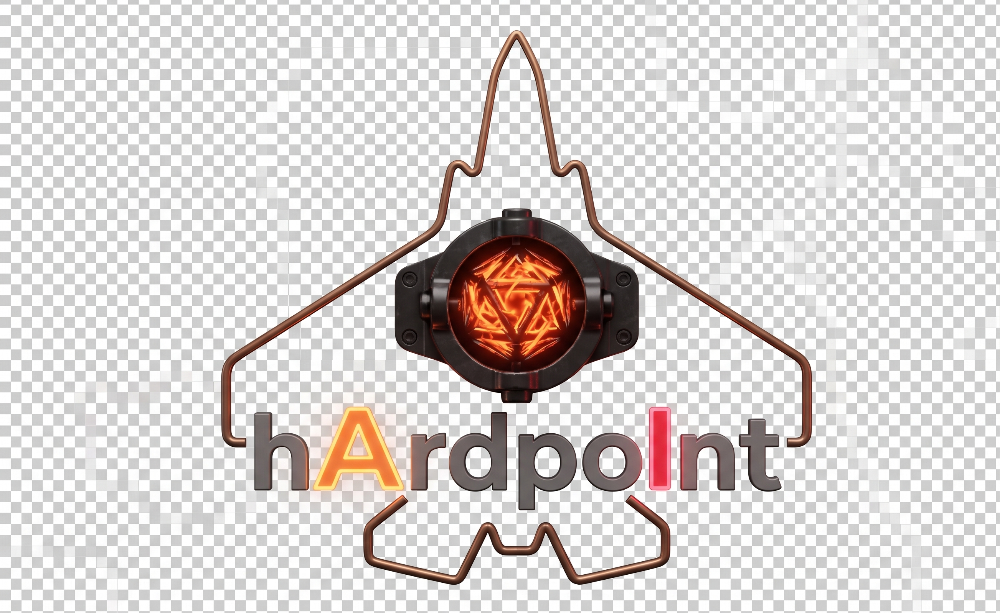

# Hardpoint

Local dashboard for **local AI / tool servers** and **NVIDIA GPU** status on this machine. You scan localhost or add presets (Ollama, Chatterbox, ComfyUI, Wreckfest 2 server, …) — nothing is forced onto the dashboard. A mount's status can come from an HTTP request, a TCP port, or a process running from its launch folder (for servers with no HTTP endpoint). Start/Stop use each card’s actions; a loopback HTTP API supports embeds.

This repo follows the shared conventions in [gerp93/KVG_Standards](https://github.com/gerp93/KVG_Standards) (theming, release/CI, update-check, licensing, logo/branding) — see that repo for the rules this one is expected to keep up with.

## Mounts

With more than one mount, the Mounts card gets a search box (name, URL or folder), **All / Up / Down / Unknown** filters with counts, and a sort menu (added order, name A–Z or Z–A, up first, down first). Your choice is remembered.

## Commands

The **Commands** tab (desktop window only) is a board of saved commands you run with one click, so you stop retyping long ones: `ssh kvg@192.168.68.110 punctual sync`, a service restart, a log tail. Each command has a name, an optional group, where it runs, the command line, a timeout and an "ask before running" switch.

- **Where it runs:** this PC (`cmd.exe`), or over SSH to a saved host. SSH uses your system `ssh` and your keys: no passwords are stored, and it never prompts (`BatchMode`). A key with a passphrase must be loaded in ssh-agent, and a new server must be trusted once from a terminal (`ssh user@host`). **Test** on a host checks the connection.
- **Output:** streams live, then shows the exit code, duration and when it ran. The last run (and the last 16 KB of its output) is kept in `command-runs.json` in the app data folder, apart from the config. **Cancel** stops a run; so does the timeout (1 s to 1 h).
- **Safety:** commands run only from the app window. They are not on the HTTP API and the Assistant cannot see, run or change them. The window sends only an id; Hardpoint runs the saved text. Anything that deletes, restarts, kills or asks for admin rights always shows a native confirmation with the exact line first, and commands that look like they hold a password or token are flagged when you save.
- **Not in this version:** scheduling, file transfer, parameters, a secrets store, interactive commands (sudo prompts, editors).

## MCP servers

The **MCP servers** card on the Dashboard (desktop window) lists the MCP servers running on this PC. It finds them three ways: servers your apps declare in config files (Claude Desktop, Claude Code, Cursor, Windsurf and VS Code locations, plus any config file you add with **Add config file…**; env values are never read), processes whose command line looks like an MCP server, and helper processes (node, python, uvx, …) that an MCP app started but no config explains. Each row shows which app started it, how long it has run, and its ports. A server whose launching app has exited is flagged **Orphaned**, and **Stop** (or **Stop all orphaned**) ends it, so you don't need Task Manager. **Where it looks for servers** shows every config location checked and whether it exists on this PC.

## Assistant

The floating **Assistant** button (desktop window only) opens a chat where you say which server you want to run. It researches the install, works out the start command, port, status check and stop method, and — after you approve — saves the mount so you only click Start next time.

- Runs on the Claude binary bundled with Hardpoint; use **Sign in** once (opens your browser, Hardpoint never sees your password).
- **What it can do:** read files on this PC (never credentials, keys or browser data), search the web, and create, edit, delete, start and stop Hardpoint mounts.
- **What it can't do:** write, edit or delete any file, run its own commands, or install software. It isn't given those tools at all. When something needs doing, it tells you the exact steps.
- **Approvals:** saving a mount shows you what will run (Start/Stop commands, status check, Open URL) and asks once; after you approve, it can start/stop that mount without asking again. Deleting a mount, or fetching a page outside well-known doc hosts (GitHub, Hugging Face, PyPI, npm, Read the Docs), also asks.
- The only command that ever runs is a mount's Start/Stop command. Commands that delete files, change system settings, ask for admin rights, push to git, or download-and-run code are refused when it saves a mount.

## Loopback API

`127.0.0.1:3921` answers only loopback Host headers (no DNS rebinding), and anything that changes state must come from a program with no browser Origin (Node, Python, Electron main) or from a page served from loopback. Websites and `null`-origin frames are refused, so a page you visit can't save or start a mount.

## Development

```
npm install
npm run generate-icons   # after changing assets/logo.png
npm run dev
npm test                 # vitest
npm run typecheck
```

The renderer dev server runs on port **5174** (Vite). The main process serves `http://127.0.0.1:3921/api/status` for local embeds (RolePlaymate / KVGenius). `GET /` redirects to the Vite UI in development and serves the packaged renderer when installed.

## Build

```
npm run build
npm run package
```

## Releases

Every push to `main` triggers [Auto Release](.github/workflows/auto-release.yml), which bumps a semantic version tag and calls [KVG_Standards' `release-electron.yml`](https://github.com/gerp93/KVG_Standards/blob/main/.github/workflows/release-electron.yml). [Cut Release](.github/workflows/cut-release.yml) is available for a manually chosen version. To force a release with no code change, add a dated entry to [`VERSION_BUMP.md`](VERSION_BUMP.md).
